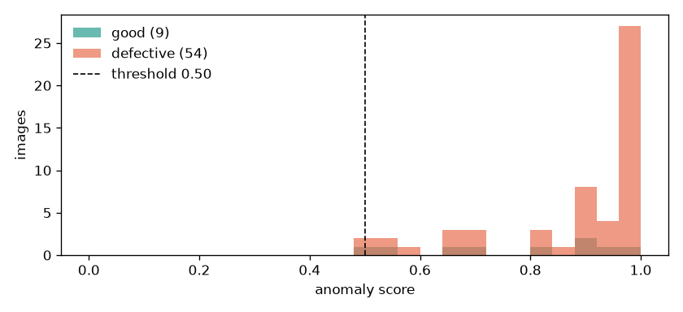
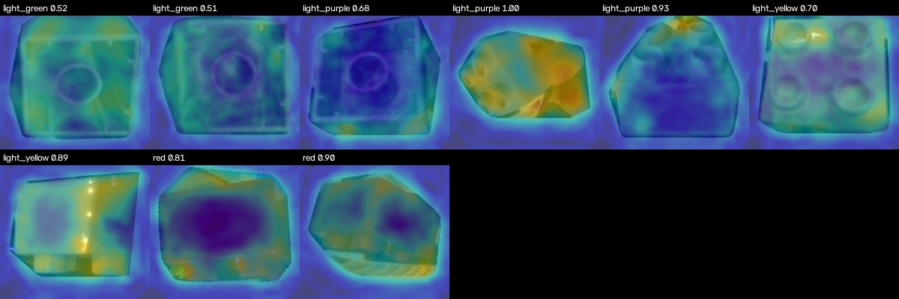
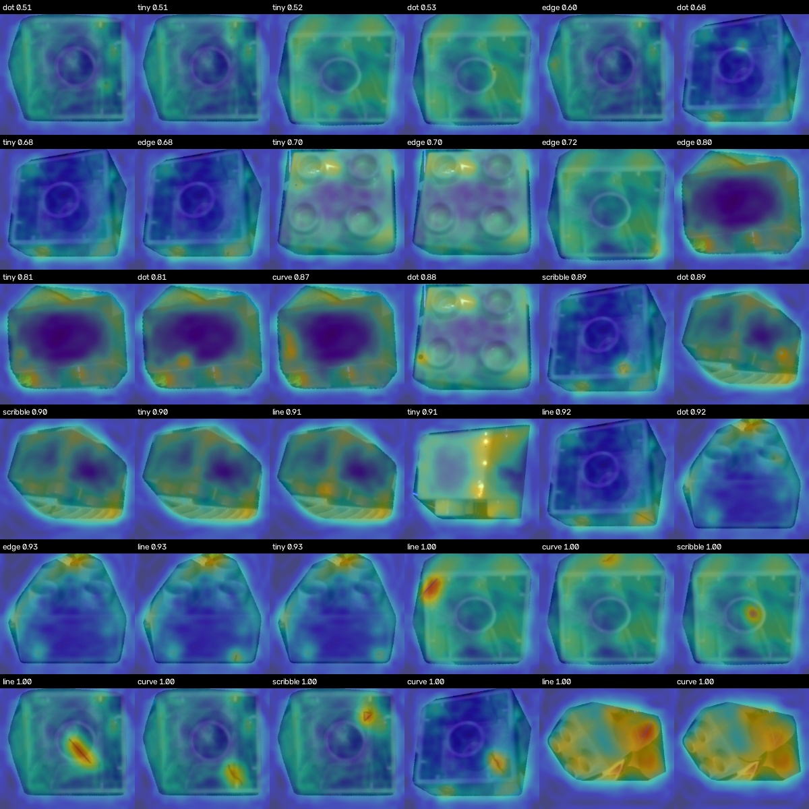

# Anomaly report - 2026-11-14 12:42

Model: PatchCore (wide_resnet50_2), fp16, input 256 px, trained 2026-11-14 12:40:36 on 69 good bricks (light_green, light_purple, light_yellow, red), camera `ground`.

Test set = 10 % of the good bricks of every colour (never seen in training) + synthetic marker defects drawn on exactly those bricks.

## Result

| metric | value |
|---|---|
| AUROC (good vs defective, threshold-free) | **0.725** |
| defects caught at threshold 0.50 | 54/54 |
| good bricks wrongly flagged | 9/9 |
| F1 at threshold | 0.923 |
| best-F1 threshold on this test set | 0.506 (F1 0.923) |

## Per defect kind (AUROC vs all held-out good bricks)

| kind | caught | AUROC | mean score |
|---|---|---|---|
| curve | 9/9 | 0.901 | 0.986 |
| dot | 9/9 | 0.549 | 0.803 |
| edge | 9/9 | 0.605 | 0.825 |
| line | 9/9 | 0.895 | 0.972 |
| scribble | 9/9 | 0.883 | 0.977 |
| tiny | 9/9 | 0.519 | 0.772 |

## Per colour

| colour | good | defective | AUROC | good passed | defects caught |
|---|---|---|---|---|---|
| light_green | 2 | 12 | 0.854 | 0/2 | 12/12 |
| light_purple | 3 | 18 | 0.583 | 0/3 | 18/18 |
| light_yellow | 2 | 12 | 0.812 | 0/2 | 12/12 |
| red | 2 | 12 | 0.667 | 0/2 | 12/12 |

## Full pipeline on every raw frame

101 frames: brick found in 78, `no_brick` in 23 (see `frames.csv`, `qa_skipped.jpg`). Time per frame with a brick: median 126 ms, 95 % 146 ms (brick finding + model).

## Speed per OpenVINO device

| device | status | model only ms | full frame ms |
|---|---|---|---|
| CPU | ok | 103 | 140 |

## Pictures

Held-out good bricks (should stay blue):

Synthetic defects, lowest scores first (the hardest ones):

Brick finding: `qa_crops.jpg`, `qa_masks.jpg`, `qa_skipped.jpg`. Every test image: `heatmaps/`.

Caveat: test good bricks come from the same sessions as training (no separate test session yet), and the defects are synthetic. Collect a separate good session and real defective bricks for a final number.